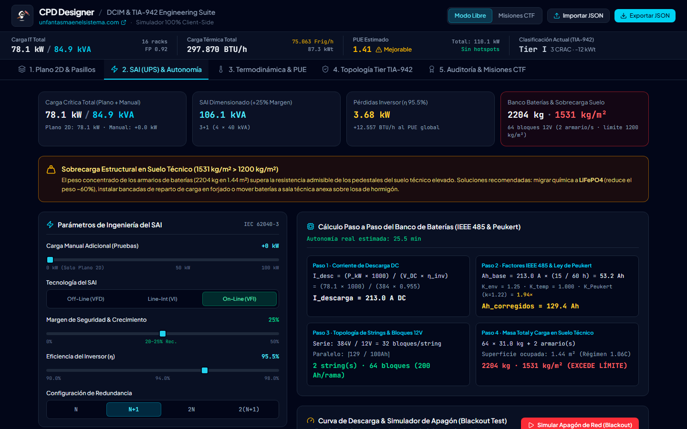
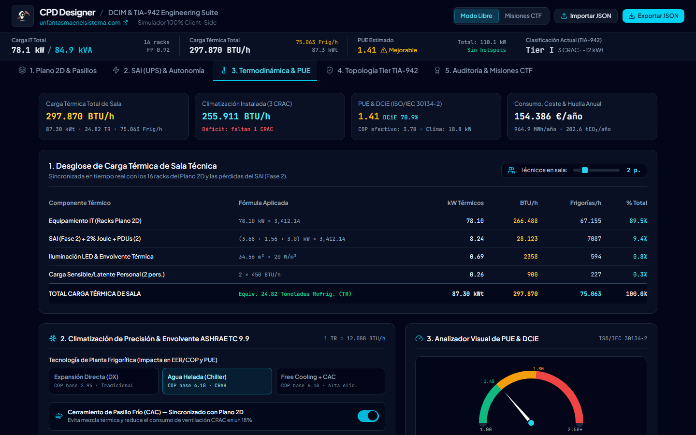
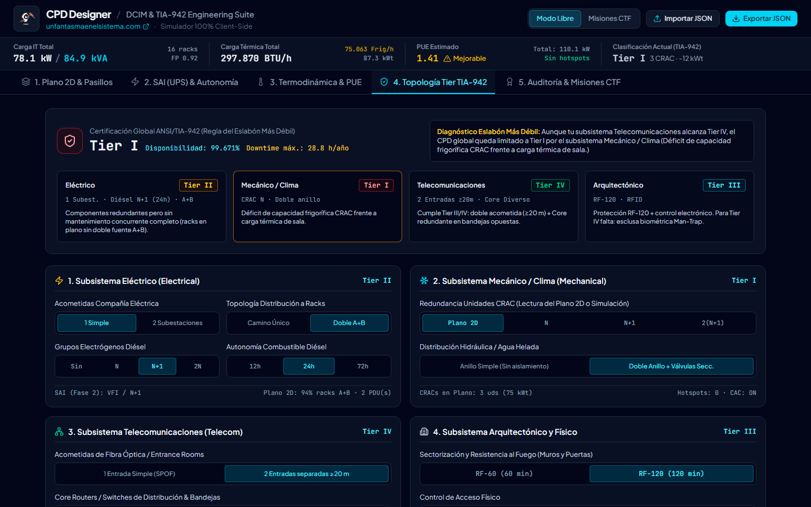
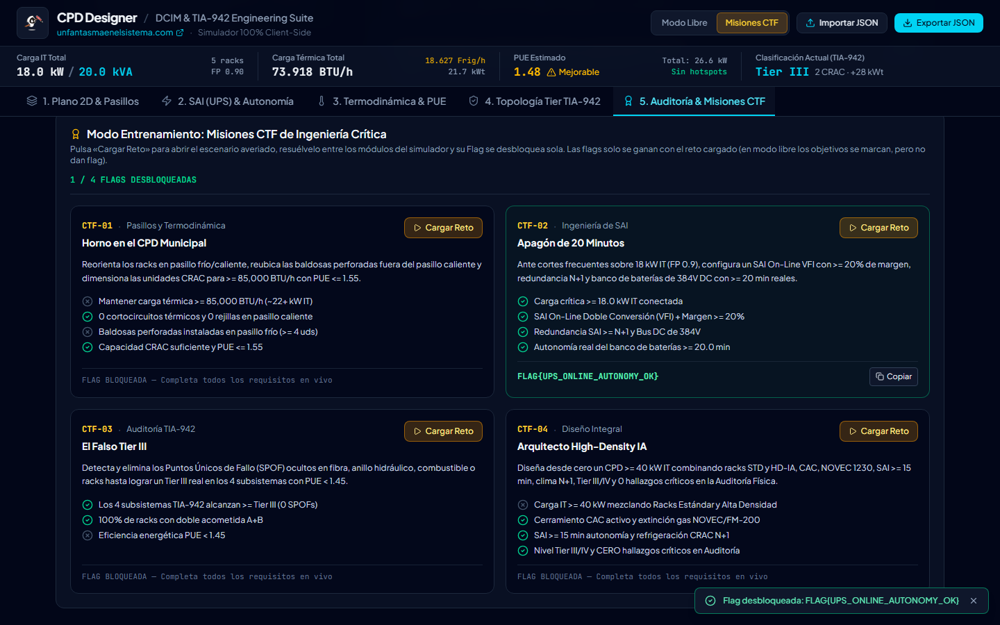
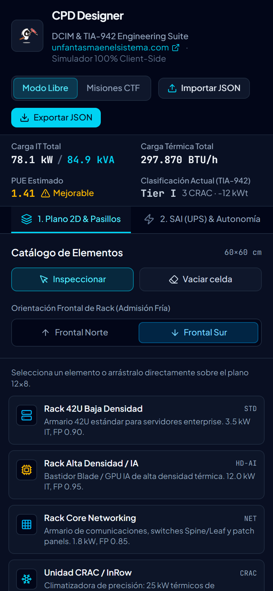

<div align="center">
  <a href="https://www.unfantasmaenelsistema.com/">
    
  </a>

# CPD Designer — DCIM & TIA-942 Engineering Suite

[](https://unfantasmaenelsistema.github.io/CPD-Designer/)
[](#instalación-y-desarrollo-local)
[](./LICENSE)

**[▶ Abrir el simulador](https://unfantasmaenelsistema.github.io/CPD-Designer/)**
</div>

Simulador interactivo profesional y educativo de diseño, cálculo electromecánico, termodinámica, topología de redundancia **ANSI/TIA-942** y auditoría técnica de Centros de Proceso de Datos (CPD / Data Centers), ejecutado **100% en cliente (sin backend)** y preparado para despliegue estático en **GitHub Pages**.

Autoría y proyecto educativo vinculado a [unfantasmaenelsistema.com](https://www.unfantasmaenelsistema.com/).

## Tabla de Contenidos

- [Capturas de Pantalla](#capturas-de-pantalla)
- [Módulos de Ingeniería](#módulos-de-ingeniería)
- [Modo Entrenamiento: Misiones CTF](#modo-entrenamiento-misiones-ctf)
- [Instalación y Desarrollo Local](#instalación-y-desarrollo-local)
- [Despliegue en GitHub Pages](#despliegue-en-github-pages)
- [Novedades de la versión 2](#novedades-de-la-versión-2)
- [Licencia](#licencia)

---

## Capturas de Pantalla

> Capturas de la versión 2 tomadas sobre la compilación de producción (en la última, el reto CTF-02 cargado y resuelto).

### 1. Plano 2D de Suelo Técnico & Pasillos Fríos/Calientes


### 2. Dimensionamiento SAI (UPS), Banco de Baterías & Blackout Simulator


### 3. Termodinámica, Carga Térmica BTU/h, ASHRAE TC 9.9 & PUE


### 4. Topología Tier ANSI/TIA-942 (Regla del Eslabón Más Débil)


### 5. Auditoría Técnica Live Linter, Informe PDF & Misiones CTF



### 6. Versión móvil


---

## Módulos de Ingeniería

1. **Plano de Sala Técnica & Pasillos Fríos/Calientes (Matriz 12 × 8, baldosas 60 × 60 cm)**
   - Colocación mediante clic o *drag-and-drop* de Racks Estándar (`STD`), Racks de Alta Densidad IA (`HD-AI`), Racks Core Networking (`NET`), unidades `CRAC/InRow`, baldosas perforadas y ciegas, `SAI/PDU` y extinción por gas limpio `NOVEC 1230 / FM-200`.
   - Rotación de racks 180° (doble clic o tecla `R`), detección automática de cortocircuitos térmicos (*Hotspots* cara caliente contra admisión fría), rejillas perforadas mal ubicadas en pasillo caliente y cerramiento de Pasillo Frío (**CAC**, -18% en ventilación CRAC).
   - Inspector de rack en tiempo real con ajuste de kW (`0.5–20 kW`), Factor de Potencia (`cos φ 0.80–0.99`), ocupación `U` y doble acometida `A+B`.

2. **Dimensionamiento SAI (UPS) & Autonomía**
   - Lectura en tiempo real de kW y kVA totales del plano + carga manual adicional para pruebas.
   - Comparativa normativa **IEC 62040-3** (`VFD Off-Line`, `VI Line-Interactive`, `VFI On-Line Doble Conversión`), margen de crecimiento (`0–50%`), eficiencia del inversor (`90–98%`) y redundancia (`N`, `N+1`, `2N`, `2(N+1)`).
   - Cálculo paso a paso de banco de baterías **IEEE 485 + Ley de Peukert** (`VRLA AGM` vs `LiFePO4`), verificación de sobrecarga estructural sobre suelo técnico (`kg/m²`), curva de descarga en `<canvas>` y simulador interactivo de corte eléctrico (**Blackout Test**) con transferencia ATS a Grupo Electrógeno en 15s.

3. **Termodinámica, Carga Térmica (BTU/h) & PUE**
   - Desglose en vivo de equipamiento IT ($\text{kW} \times 3412.14\text{ BTU/h}$), pérdidas del SAI (Fase 2), 2% Joule + PDUs, iluminación/envolvente ($20\text{ W/m}^2$) y carga por operarios ($N \times 450\text{ BTU/h}$).
   - Conversión instantánea a **BTU/h**, **Frigorías/h**, **kW térmicos** y **Toneladas de Refrigeración (TR)**, evaluando capacidad instalada CRAC frente a redundancia `N+1`.
   - Mapa psicrométrico interactivo **ASHRAE TC 9.9** (zona recomendada `18–27 °C` y `40–60% HR`), tecnologías de enfriamiento (`DX`, `Chiller`, `Free Cooling`) y velocímetro visual **PUE / DCiE (ISO/IEC 30134-2)** con estimación anual de MWh, coste en €/año y huella de $\text{tCO}_2$.

4. **Topología Tier ANSI/TIA-942 & Regla del Eslabón Más Débil**
   - Configurador de los 4 subsistemas (**Eléctrico**, **Mecánico/Clima**, **Telecomunicaciones** y **Arquitectónico**).
   - Motor de evaluación que aplica el principio de cadena crítica: el nivel Tier global (`Tier I` a `Tier IV`) queda limitado por el subsistema más débil.
   - Simulador interactivo de fallos y mantenimiento concurrente sobre un diagrama unifilar SVG para visualizar Puntos Únicos de Fallo (**SPOF**).

5. **Auditoría Técnica & Misiones CTF**
   - **Live Engineering Linter**: escaneo integral (Críticos, Graves, Leves y Conformes) sobre capacidad SAI, CRAC `N+1`, flujo de aire 2D, agente limpio `NOVEC/FM-200`, prohibición explícita de rociadores húmedos sobre racks, ASHRAE, PUE `< 1.50`, puesta a tierra equipotencial **TIA-607 (CBN/Mesh-BN)**, sensores de inundación (*Leak Detection Rope*) y pulsador **EPO** con cubeta protectora.
   - **Generador de Informe Técnico**: vista previa limpia imprimible en PDF (`window.print()`) con dictamen firmado y tabla resumen de cálculos.
   - **Persistencia local (`localStorage`) + Exportación/Importación JSON** + botón de reinicio de fábrica. Al cargar o importar, cada valor se limita al rango de su control en la interfaz y las flags no se importan: se desbloquean solas si el diseño cumple el reto.

---

## Modo Entrenamiento: Misiones CTF

Pulsa **Cargar Reto** en la Pestaña 5 para desplegar el escenario averiado de cada misión. Su *Flag* se desbloquea automáticamente al cumplir todos los criterios en tiempo real **con ese reto cargado** (modo Misiones CTF). En modo libre los objetivos se marcan igualmente, pero no dan flag.

| Código | Misión | Enfoque Técnico |
| :--- | :--- | :--- |
| `CTF-01` | **Horno en el CPD Municipal** | Pasillos frío/caliente, rejillas perforadas y CRAC para >= 85.000 BTU/h con PUE <= 1.55 |
| `CTF-02` | **Apagón de 20 Minutos** | SAI On-Line VFI, >= 20% margen, redundancia `N+1`, bus 384V DC y >= 20 min reales |
| `CTF-03` | **El Falso Tier III** | Eliminación de SPOFs en TIA-942, 100% racks A+B y PUE < 1.45 |
| `CTF-04` | **Arquitecto High-Density IA** | Diseño desde cero >= 40 kW IT (STD + HD-AI), CAC, NOVEC 1230, SAI >= 15 min, clima `N+1`, Tier III/IV y 0 críticos |

Las flags se calculan en el navegador: son una evidencia educativa para la clase, no una prueba frente a quien lea el código.

---

## Instalación y Desarrollo Local

Requisitos: **[Bun](https://bun.sh/)** (el proyecto usa `bun.lock`).

```bash
git clone https://github.com/unfantasmaenelsistema/CPD-Designer.git
cd CPD-Designer
bun install
bun run dev        # http://localhost:3000
bun run lint       # comprobación de tipos con TypeScript
bun run build      # genera ./dist para publicar
```

La compilación genera la carpeta estática `dist/` con rutas relativas (`base: './'` en `vite.config.ts`).

---

## Despliegue en GitHub Pages

El flujo [`.github/workflows/deploy.yml`](./.github/workflows/deploy.yml) se ejecuta en cada `push` a `main`: instala con Bun (`bun install --frozen-lockfile`), compila `./dist` y lo publica en https://unfantasmaenelsistema.github.io/CPD-Designer/ (en **Settings → Pages**, la fuente es **GitHub Actions**).

---

## Novedades de la versión 2

- **Publicado en GitHub Pages.** El workflow fallaba en segundos (`npm ci` sin `package-lock.json`) y Pages no estaba activado; ahora compila con Bun.
- **Flags que hay que ganarse.**
  - En modo libre, la sala tipo ya cumplía casi todo: la flag del SAI salía con solo subir la autonomía objetivo a 20 min, y las tarjetas mostraban la flag en cuanto se cumplían los objetivos.
  - Ahora las flags solo se ganan con el reto cargado. El modo y el reto activo se guardan, así que el progreso sigue tras recargar.
- **Proyectos guardados e importados validados.**
  - Un valor fuera de los rangos de la interfaz (por ejemplo, baterías de 999 999 Ah) entraba tal cual.
  - Las flags del archivo se daban por capturadas, aunque fueran inventadas.
  - Un plano con celdas vacías o mal formadas dejaba la página en blanco, y seguía así en cada recarga.
  - Ahora cada número se limita a su control, cada celda se reconstruye con su tipo, solo valen flags reales y las flags no se importan.
- **Móvil:** la cabecera ya no se sale de la pantalla.
- **Licencia MIT** (el repositorio no tenía `LICENSE`).
- **Limpieza:** fuera Gemini, Express, `motion`, el plugin de copia de AI Studio, `metadata.json` y `.env.example`. El logo pasa a `public/assets/logo.png` y también es el favicon. El escritorio queda idéntico píxel a píxel en las cinco pestañas, salvo el texto nuevo del panel de misiones.

---

## Licencia

Distribuido bajo la licencia [MIT](./LICENSE).
