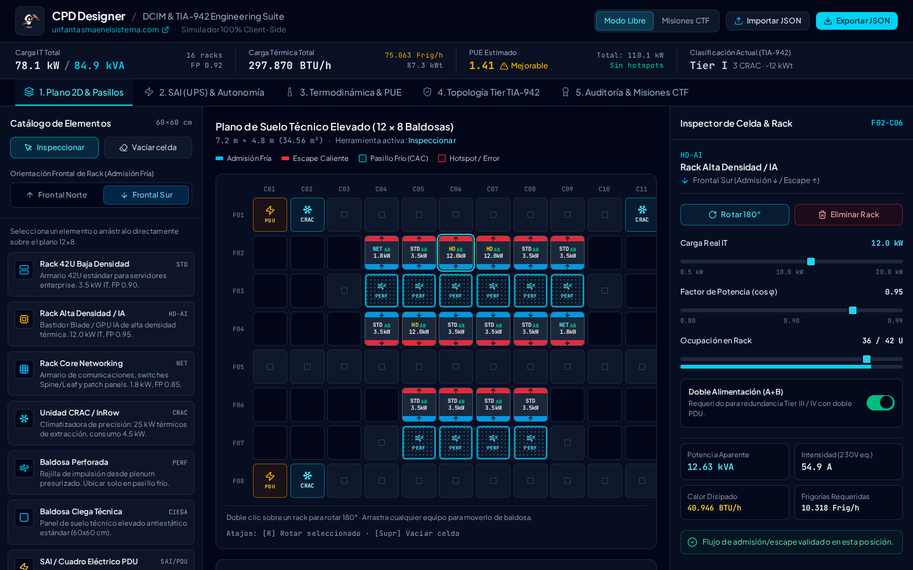
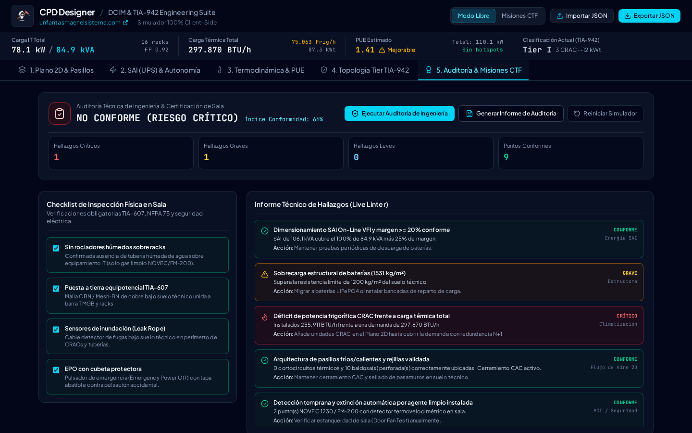

# CPD Designer — DCIM & TIA-942 Engineering Suite

Simulador interactivo profesional y educativo de diseño, cálculo electromecánico, termodinámica, topología de redundancia **ANSI/TIA-942** y auditoría técnica de Centros de Proceso de Datos (CPD / Data Centers), ejecutado **100% en cliente (sin backend)** y preparado para despliegue estático en **GitHub Pages**.

Autoría y proyecto educativo vinculado a [unfantasmaenelsistema.com](https://www.unfantasmaenelsistema.com/).

---

## Capturas de Pantalla

### 1. Plano 2D de Suelo Técnico & Pasillos Fríos/Calientes


### 2. Dimensionamiento SAI (UPS), Banco de Baterías & Blackout Simulator


### 3. Termodinámica, Carga Térmica BTU/h, ASHRAE TC 9.9 & PUE


### 4. Topología Tier ANSI/TIA-942 (Regla del Eslabón Más Débil)


### 5. Auditoría Técnica Live Linter, Informe PDF & Misiones CTF



---

## Módulos de Ingeniería

1. **Plano de Sala Técnica & Pasillos Fríos/Calientes (Matriz 12 × 8, baldosas 60 × 60 cm)**
   - Colocación mediante clic o *drag-and-drop* de Racks Estándar (`STD`), Racks de Alta Densidad IA (`HD-AI`), Racks Core Networking (`NET`), unidades `CRAC/InRow`, baldosas perforadas y ciegas, `SAI/PDU` y extinción por gas limpio `NOVEC 1230 / FM-200`.
   - Rotación de racks 180° (doble clic o tecla `R`), detección automática de cortocircuitos térmicos (*Hotspots* cara caliente contra admisión fría), rejillas perforadas mal ubicadas en pasillo caliente y cerramiento de Pasillo Frío (**CAC**, -18% en ventilación CRAC).
   - Inspector de rack en tiempo real con ajuste de kW (`0.5–20 kW`), Factor de Potencia (`cos φ 0.80–0.99`), ocupación `U` y doble acometida `A+B`.

2. **Dimensionamiento SAI (UPS) & Autonomía**
   - Lectura en tiempo real de kW y kVA totales del plano + carga manual adicional para pruebas.
   - Comparativa normativa **IEC 62040-3** (`VFD Off-Line`, `VI Line-Interactive`, `VFI On-Line Doble Conversión`), margen de crecimiento (`0–50%`), eficiencia del inversor (`90–98%`) y redundancia (`N`, `N+1`, `2N`, `2(N+1)`).
   - Cálculo paso a paso de banco de baterías **IEEE 485 + Ley de Peukert** (`VRLA AGM` vs `LiFePO4`), verificación de sobrecarga estructural sobre suelo técnico (`kg/m²`), curva de descarga en `<canvas>` y simulador interactivo de corte eléctrico (**Blackout Test**) con transferencia ATS a Grupo Electrógeno en 15s.

3. **Termodinámica, Carga Térmica (BTU/h) & PUE**
   - Desglose en vivo de equipamiento IT ($\text{kW} \times 3412.14\text{ BTU/h}$), pérdidas del SAI (Fase 2), 2% Joule + PDUs, iluminación/envolvente ($20\text{ W/m}^2$) y carga por operarios ($N \times 450\text{ BTU/h}$).
   - Conversión instantánea a **BTU/h**, **Frigorías/h**, **kW térmicos** y **Toneladas de Refrigeración (TR)**, evaluando capacidad instalada CRAC frente a redundancia `N+1`.
   - Mapa psicrométrico interactivo **ASHRAE TC 9.9** (zona recomendada `18–27 °C` y `40–60% HR`), tecnologías de enfriamiento (`DX`, `Chiller`, `Free Cooling`) y velocímetro visual **PUE / DCiE (ISO/IEC 30134-2)** con estimación anual de MWh, coste en €/año y huella de $\text{tCO}_2$.

4. **Topología Tier ANSI/TIA-942 & Regla del Eslabón Más Débil**
   - Configurador de los 4 subsistemas (**Eléctrico**, **Mecánico/Clima**, **Telecomunicaciones** y **Arquitectónico**).
   - Motor de evaluación que aplica el principio de cadena crítica: el nivel Tier global (`Tier I` a `Tier IV`) queda limitado por el subsistema más débil.
   - Simulador interactivo de fallos y mantenimiento concurrente sobre un diagrama unifilar SVG para visualizar Puntos Únicos de Fallo (**SPOF**).

5. **Auditoría Técnica & Misiones CTF**
   - **Live Engineering Linter**: escaneo integral (Críticos, Graves, Leves y Conformes) sobre capacidad SAI, CRAC `N+1`, flujo de aire 2D, agente limpio `NOVEC/FM-200`, prohibición explícita de rociadores húmedos sobre racks, ASHRAE, PUE `< 1.50`, puesta a tierra equipotencial **TIA-607 (CBN/Mesh-BN)**, sensores de inundación (*Leak Detection Rope*) y pulsador **EPO** con cubeta protectora.
   - **Generador de Informe Técnico**: vista previa limpia imprimible en PDF (`window.print()`) con dictamen firmado y tabla resumen de cálculos.
   - **Persistencia local (`localStorage`) + Exportación/Importación JSON** + botón de reinicio de fábrica.

---

## Modo Entrenamiento: Misiones CTF

Activa cualquier misión desde **Modo Misiones CTF** o en la Pestaña 5 (**Cargar Reto**) para desplegar el escenario averiado y desbloquear su *Flag* automáticamente al cumplir todos los criterios en tiempo real:

| Código | Misión | Enfoque Técnico | Flag |
| :--- | :--- | :--- | :--- |
| `CTF-01` | **Horno en el CPD Municipal** | Pasillos frío/caliente, rejillas perforadas y CRAC para >= 85.000 BTU/h con PUE <= 1.55 | `FLAG{COLD_AISLE_THERMAL_MASTER}` |
| `CTF-02` | **Apagón de 20 Minutos** | SAI On-Line VFI, >= 20% margen, redundancia `N+1`, bus 384V DC y >= 20 min reales | `FLAG{UPS_ONLINE_AUTONOMY_OK}` |
| `CTF-03` | **El Falso Tier III** | Eliminación de SPOFs en TIA-942, 100% racks A+B y PUE < 1.45 | `FLAG{TIA942_CONCURRENT_MAINTENANCE}` |
| `CTF-04` | **Arquitecto High-Density IA** | Diseño desde cero >= 40 kW IT (STD + HD-AI), CAC, NOVEC 1230, SAI >= 15 min, clima `N+1`, Tier III/IV y 0 críticos | `FLAG{DCIM_CHIEF_ENGINEER_PRO}` |

---

## Instalación y Desarrollo Local

Requisitos: **Node.js 20+** y **npm**.

```bash
# 1. Clonar el repositorio e instalar dependencias
npm install

# 2. Iniciar servidor de desarrollo (puerto 3000)
npm run dev

# 3. Verificación de tipos TypeScript y build estático de producción
npm run lint
npm run build
```

La compilación genera la carpeta estática `dist/` con rutas relativas (`base: './'` en `vite.config.ts`).

---

## Despliegue en GitHub Pages

El repositorio incluye el flujo automatizado `.github/workflows/deploy.yml`:

1. Sube el proyecto a un repositorio de GitHub en la rama `main`.
2. Ve a **Settings → Pages → Build and deployment → Source** y selecciona **GitHub Actions**.
3. Cada `push` a `main` ejecutará `npm ci`, `npm run build` y publicará automáticamente `dist/` en GitHub Pages sin configuración adicional ni servidor backend.
